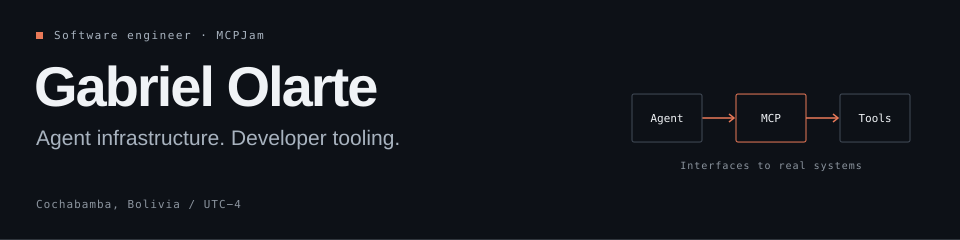

[**Work**](https://olartgabo.dev) &nbsp;·&nbsp; [**LinkedIn**](https://linkedin.com/in/gabriel-olarte-medrano-741aa331a/) &nbsp;·&nbsp; [**Email**](mailto:olartgabo@gmail.com)

## I build developer tools for AI agents.

**Software Engineer & Bolivia Site Lead at [MCPJam](https://mcpjam.com).** I work on the [open-source Inspector](https://github.com/MCPJam/inspector) and the Model Context Protocol ecosystem. I joined the team after contributing MCP servers independently.

Recent merged work includes [SDK test-harness build](https://github.com/MCPJam/inspector/pull/6002), [API error handling](https://github.com/MCPJam/inspector/pull/5747), and [dependency security fixes](https://github.com/MCPJam/inspector/pull/6100). [More contributions →](https://github.com/MCPJam/inspector/pulls?q=is%3Apr+author%3Aolartgabo)

I also founded **Meliorem**, an AI automation studio delivering systems for corporate clients on event-driven AWS infrastructure.

## Things you can inspect

| Project | What I'm building |
| :--- | :--- |
| **[VELA](https://github.com/olartgabo/vela)** | Vector search written from scratch in **Rust**: HNSW, product quantization, SIMD kernels, persistent storage, and agent memory over MCP. Early-stage systems work. |
| **[Design DNA MCP](https://github.com/olartgabo/design-dna-mcp)** | Capture websites with Playwright, extract UI patterns with Claude, and search a curated SQLite library through MCP. |
| **[NetPilot](https://github.com/olartgabo/netpilot)** | A network-policy studio with deterministic ACL evaluation, explainable traffic decisions, and policy-change comparisons. |
| **[boxMouse](https://github.com/olartgabo/boxMouse)** | An Xbox controller as a Windows mouse, terminal control surface, and window-management remote. Python's standard library and native Windows APIs. |

More system architecture and project context: **[olartgabo.dev](https://olartgabo.dev)**. Agent-readable profile: **[llms.txt](https://olartgabo.dev/llms.txt)**.

## How I work

I move between the interface and the system behind it: TypeScript and React for developer tools, Rust for search infrastructure, Python for automation, and AWS for application delivery. Competitive programming shaped how I reason about algorithms and constraints; client work made deployment and maintenance part of the job.

I founded the AWS Cloud Club at UPB and help build the student AWS community in Bolivia. I'm studying Systems Engineering at Universidad Privada Boliviana.

**Cochabamba, Bolivia · UTC−4.** Open to conversations about developer tools, agent infrastructure, and software for LATAM.
